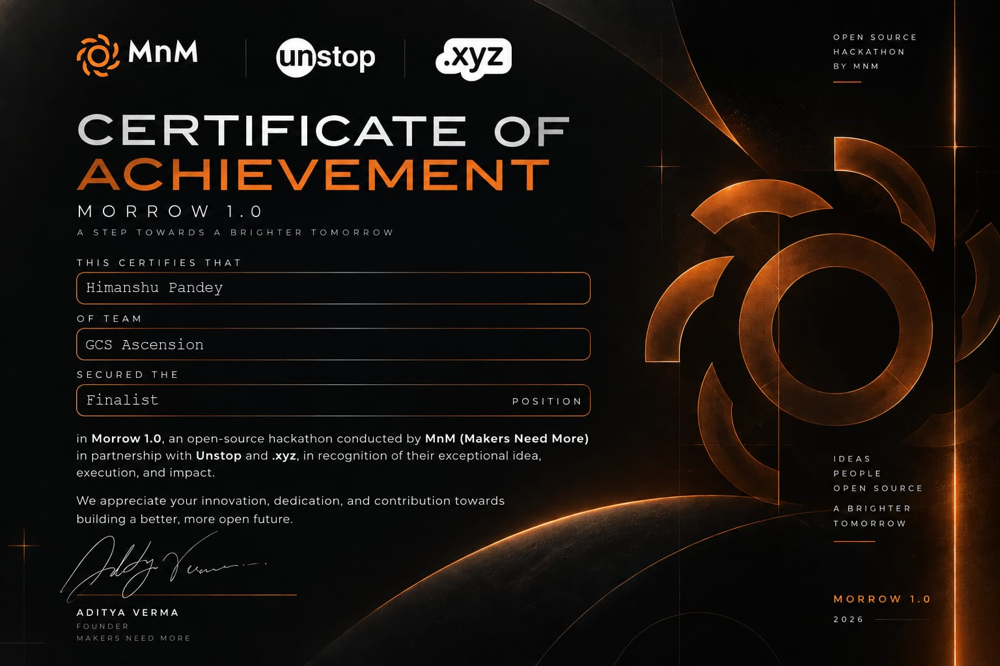

## 👨‍💻 About Me

- 🎓 B.Tech student at PSIT, Kanpur
- 💻 Interested in Backend Development and Databases
- 🌱 Exploring AI, Web Development and System Design
- 🔨 Building practical, real-world software projects
- 🎯 Goal: Become a skilled Software Engineer
- 🤝 Open to learning and collaborating

## 🛠️ Tech Stack

### Programming Languages

### Backend & Databases

### Tools & Platforms

## 📊 GitHub Statistics

## 🚀 Featured Projects

### 🗑️ SwachhLens
AI-powered civic waste reporting and cleanup verification platform.

- Citizen waste reporting
- AI-based waste classification
- Employee cleanup verification
- Backend APIs and database integration

[View SwachhLens](https://github.com/himanshupandey543/swachh_lens)

<!-- ================= CERTIFICATIONS ================= -->

<h2 align="center">🏆 Certifications & Achievements</h2>

  My collection of technical certifications, hackathons,
  competitions, and leadership initiatives.

<h3>💻 Technical Certifications</h3>

<table>
<tr>
<td align="center" width="50%">
  <h4>🗄️ Database Management System</h4>
  
</td>
<td align="center" width="50%">
  <h4>🌐 HTML</h4>
  
</td>
</tr>

<tr>
<td align="center">
  <h4>🎨 CSS</h4>
  
</td>
<td align="center">
  <h4>⚡ JavaScript</h4>
  
</td>
</tr>

<tr>
<td align="center">
  <h4>🐍 Python Programming</h4>
  
</td>
<td align="center">
  <h4>🤖 Machine Learning by Python</h4>
  
</td>
</tr>

<tr>
<td align="center" colspan="2">
  <h4>📊 Exploratory Data Analysis</h4>
  
</td>
</tr>
</table>

<h3>🚀 Hackathons & Technical Events</h3>

<table>
<tr>
<td align="center" width="50%">
  <h4>💻 DevHack</h4>
  
</td>
<td align="center" width="50%">
  <h4>👨‍💻 Geeks2Code</h4>
  
</td>
</tr>

<tr>
<td align="center">
  <h4>🔥 HackSynergy</h4>
  
</td>
<td align="center">
  <h4>🚀 Morrow</h4>
  
</td>
</tr>

<tr>
<td align="center" colspan="2">
  <h4>🏅 TechNova</h4>
  
</td>
  <td align="center" width="50%">
    <h4>🏆 Gradient</h4>
    
  </td>
</tr>
</table>

<h3>🧠 Quizzes & Competitions</h3>

<table>
<tr>
<td align="center" width="50%">
  <h4>🏆 QuizVerse</h4>
  
</td>

<td align="center" width="50%">
  <h4>🇮🇳 TB Mukt Bharat Abhiyan Quiz</h4>
  
</td>
</tr>
</table>

<h3>🌍 Leadership & National Initiatives</h3>

<h4>🇮🇳 Viksit Bharat Young Leaders Dialogue</h4>

 

<h3 align="center">🖼️ Certificate Highlights</h3>

  

<!-- =============== END CERTIFICATIONS =============== -->

## 📈 My GitHub Contributions

## 🌐 Connect With Me

---

### Thanks for visiting!

